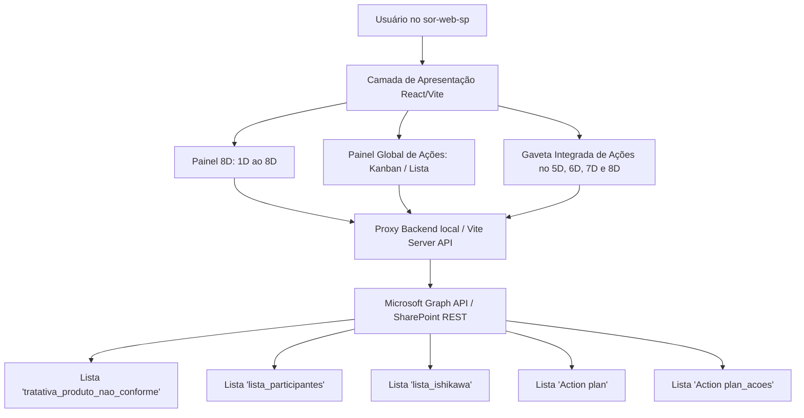
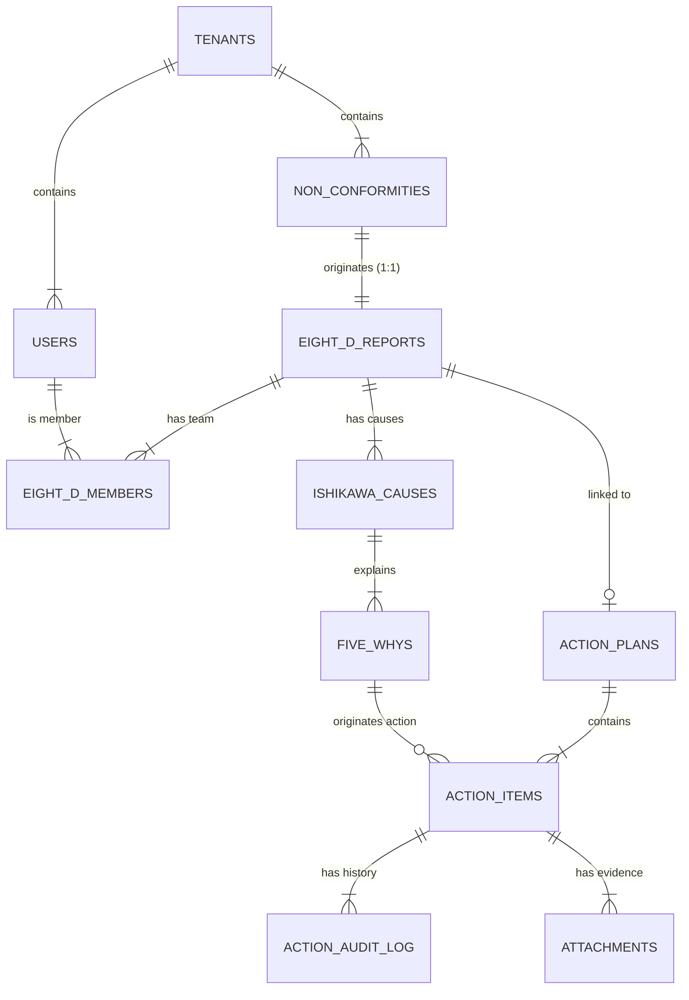
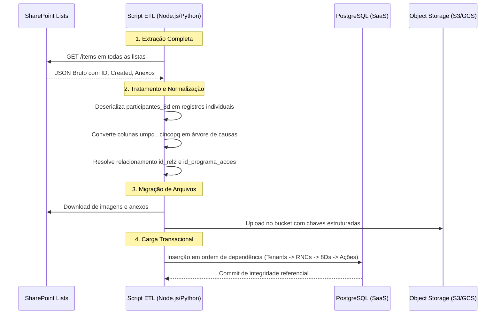

# Plano Estratégico de Implementação: SOR 8D & Plano de Ação

Este documento apresenta a estratégia completa de evolução dos aplicativos **SOR - Gestão de 8D** e **SOR - Plano de Ação**, dividida em duas visões estratégicas:
1. **Plano 1: Implementação Unificada no SharePoint Edition (`sor-web-sp`)** — Otimização máxima da UX e das integrações mantendo 100% da retrocompatibilidade com as listas existentes do SharePoint.
2. **Plano 2: Migração e Modernização para SaaS (Cloud Relacional / PostgreSQL)** — Redesenho arquitetural e modelo relacional normalizado sem limitações de delegação, pronto para escala industrial (IATF 16949 / VDA).

---

## Diagnóstico Crítico: Gargalos Atuais e Oportunidades de Melhoria

Ao auditar os dois aplicativos Canvas mapeados, identificamos pontos técnicos e operacionais que hoje impactam a produtividade, integridade de dados e escalabilidade:

### 1. No App de Gestão de 8D
- **Participantes Serializados em String Única (`participantes_8d`):** Os membros da equipe (2D) são salvos como `"Nome 1, Nome 2, Nome 3"`. Isso impede filtros analíticos por colaborador, métricas de envolvimento e notificações limpas por usuário.
- **Rígida Estrutura dos 5 Porquês (`umpq`, `doispq`... `cincopq`):** O modelo força exatamente 5 colunas fixas por linha. Em muitas investigações de chão de fábrica, a causa raiz pode ser encontrada no 3º porquê ou requerer uma árvore com derivações (não linear).
- **Desconexão de Sessão via `Launch()` para o Plano de Ação:** O 8D abre uma nova aba no navegador para chamar o app de ações (`bb7b1186-e490-40e2-980e-ba5defd05877`). Isso quebra a navegação do usuário, exige novos logins e requer que ele dê "Refresh" manual ao retornar ao 8D.
- **Auditoria de Revisão Fragilizada:** As aprovações e pedidos de revisão de cada etapa (4D, 5D, 6D, 7D) gravam em colunas soltas na tabela de participantes (`4D_revisado`, `4D_comentarios_revisao`), misturando o cadastro da equipe com os pareceres técnicos de qualidade.

### 2. No App de Plano de Ação
- **Duplicidade e Risco de Quebra Relacional:** O mestre `'Action plan'` usa `idprograma` (ex: `"I - 4520"`), e as ações detalhadas usam tanto `id_rel2` (ID do mestre) quanto `id_programa_acoes`. Se o usuário alterar ou criar uma ação sem passar a referência de programa, ela se perde da visualização do 8D.
- **Ausência de Trilha de Auditoria (Audit Trail) para Prazos:** Quando uma data planejada é prorrogada, o app apenas substitui `data_planejada` e preenche `data_plan_anterior`, sem guardar quem aprovou a prorrogação, a data do pedido e a justificativa histórica.
- **Falta de Validação em Lote:** O auditor de qualidade precisa validar ou reprovar ação por ação abrindo modais repetitivos, tornando a homologação do 8D lenta.
- **Gargalo de Delegação do SharePoint (500/2000 itens):** No Power Apps Canvas, consultas filtradas em listas que ultrapassam o limite de delegação podem ocultar ações abertas ou gerar contagens incorretas no Kanban.

---

# PARTE 1: Plano de Implementação Unificado (SharePoint Edition - `sor-web-sp`)

### Objetivo
Construir no repositório `sor-web-sp` uma aplicação web de alta performance que una a gestão de 8D e o controle de Planos de Ação numa única interface fluida, **sem alterar o esquema ou nomes de colunas das listas do SharePoint**, garantindo compatibilidade total com os usuários que ainda utilizam o Power Apps Studio.

---

### Melhorias de Fluxo Implementadas nesta Edição (Sem quebrar o SharePoint)

1. **Substituição do `Launch()` por Painel Embutido (Drawer/Modal Unificado):**
   - Nas etapas 5D, 6D, 7D e 8D do 8D, as ações são exibidas, criadas, concluídas e validadas **diretamente dentro da tela**, sem redirecionamento para outra aba.
   - Sincronização em tempo real: ao salvar uma contramedida no 5D, ela reflete imediatamente no 8D e no Plano de Ação.

2. **Garantia Automática de Integridade do "Duplo Link":**
   - Ao cadastrar uma ação vinculada ao 8D, o backend/frontend injeta atomicamente:
     - `idprograma` no mestre `'Action plan'`.
     - `id_rel2` (ID numérico do cabeçalho) + `id_programa_acoes` (`varid8d`) no item `'Action plan_acoes'`.
   - Isso elimina qualquer risco de "ações órfãs" para quem acessar pelo Power Apps.

3. **Automação do 4D ➔ 5D (Ishikawa + 5 Porquês):**
   - Quando a equipe conclui o 5º Porquê (`cincopq`) de uma hipótese "NG", o sistema oferece o botão de 1 clique: **"Gerar Ação Corretiva no 5D"**.
   - O campo `causa` do formulário de ação já vem automaticamente preenchido com a causa raiz correspondente.

4. **Homologação em Lote na Etapa 8D:**
   - Tela de encerramento do 8D permite ao gestor/auditor selecionar múltiplas ações concluídas e aprovar todas de uma vez com um parecer técnico consolidado, ou reprovar com justificativa individualizada.

5. **Eliminação do Limite de Delegação:**
   - A camada de API (`/api/sp/...`) usa paginação transparente e índices do SharePoint via Graph API, permitindo carregar históricos de milhares de ações sem as travas de 2000 itens do Power Apps Canvas.

6. **Dossiê 8D em PDF com 1 Clique:**
   - Geração e impressão do relatório técnico oficial do 8D formatado, pronto para auditorias e envio para montadoras.

---

### Cronograma de Execução: `sor-web-sp`

| Fase | Entrega Técnica | Escopo & Atividades |
|---|---|---|
| **Fase 1: Backend & Contratos de API** | Endpoints SharePoint Direct Proxy (`vite.config.ts`) | - `/api/sp/8d/rncs` (RNCs com `abrir_8d = 'Sim'`) - `/api/sp/8d/:id8d/detalhes` (agregação de participantes, 6M, Ishikawa, 5PQ) - `/api/sp/planos` (criação e consulta do mestre) - `/api/sp/acoes` (CRUD de ações com filtros por `idprograma` ou `idplano`) - `/api/sp/acoes/:id/concluir` e `/api/sp/acoes/:id/validar` |
| **Fase 2: Módulo 8D (1D ao 4D)** | Telas de Diagnóstico e Investigação | - **1D:** Dados da peça, contenção, fotos do defeito. - **2D:** Seleção de equipe da `BASE_ATIVOS` com auto-lookup de cargo/email. - **4D Henkaten:** Matriz 6M de pontos de mudança. - **4D Ishikawa + 5PQ:** Diagrama visual de espinha de peixe com árvore de 5 Porquês por causa raiz. |
| **Fase 3: Módulo de Ações (5D, 6D, 7D e Plano Geral)** | Gestão de Ações Integrada | - **5D:** Ações corretivas associadas às causas raízes do 4D. - **6D:** Validação de abrangência (Yokoten) e Poka-Yoke. - **7D:** Ações preventivas em 3 eixos (FMEA, Trabalho Padronizado, Auditoria Escalonada). - **Visão Geral:** Kanban corporativo de ações (`Aberto`, `Atrasado`, `Concluído`, `Validado`). |
| **Fase 4: Etapa 8D, Validação & Dossiê** | Homologação e Relatório | - Validação individual e em lote pela Qualidade. - Workflow de devolução para revisão com registro de motivo. - Geração do dossiê completo 8D em PDF padronizado. |
| **Fase 5: Testes Integrados & Push** | Validação com Dados Reais | - Testes de gravação simultânea (Web x Power Apps). - Push final no repositório `https://github.com/MatheusHenriLuca/sor-web-sp`. |

---

# PARTE 2: Plano de Migração e Modernização para SaaS (Cloud Relacional)

### Objetivo
Desacoplar o ecossistema do SharePoint e construir uma solução SaaS corporativa independente, escalável, multi-tenant e auditável, baseada em banco de dados relacional (PostgreSQL / Supabase) e arquitetura de microsserviços/APIs tipadas.

---

### Novo Modelo de Dados Relacional Normalizado (PostgreSQL)

#### Estrutura das Tabelas Principais

1. **`eight_d_reports` (Cabeçalho do 8D):**
   - `id` (UUID PK), `tenant_id`, `rnc_id` (FK única), `code` (ex: `"8D-2026-0045"`).
   - `status` (`DRAFT`, `IN_ANALYSIS`, `ACTIONS_PENDING`, `VALIDATION`, `CLOSED`).
   - `created_at`, `closed_at`, `closed_by`.

2. **`eight_d_members` (Equipe Multidisciplinar Normalizada):**
   - `id` (UUID PK), `eight_d_id` (FK), `user_id` (FK), `role` (`CHAMPION`, `LEADER`, `MEMBER`, `QUALITY_AUDITOR`).

3. **`ishikawa_causes` & `five_whys` (Causa Raiz Normalizada):**
   - `ishikawa_causes`: `id`, `eight_d_id`, `category` (6M: `METHOD`, `MACHINE`, `MANPOWER`, `MATERIAL`, `MEASUREMENT`, `ENVIRONMENT`), `axis` (`OCCURRENCE`, `NON_DETECTION`), `description`, `is_validated` (bool).
   - `five_whys`: `id`, `ishikawa_cause_id` (FK), `parent_why_id` (auto-relacionamento para árvore dinâmica), `level` (1 a N), `why_text`, `is_root_cause` (bool).

4. **`action_plans` (Planos de Ação Mestres):**
   - `id` (UUID PK), `tenant_id`, `title`, `program_category` (ex: `"8D"`, `"KAIZEN"`, `"FAST_RESPONSE"`, `"AUDIT"`).
   - `origin_module`, `origin_reference_id` (FK genérica / polimórfica para o 8D ou outro app).
   - `priority` (`LOW`, `MEDIUM`, `HIGH`, `CRITICAL`), `status`.

5. **`action_items` (Itens de Contramedida com Ciclo de Vida Estrito):**
   - `id` (UUID PK), `action_plan_id` (FK), `root_cause_id` (FK opcional para `five_whys`).
   - `countermeasure_description`, `action_type` (`CONTAINMENT`, `CORRECTIVE`, `PREVENTIVE`, `IMPROVEMENT`).
   - `assigned_user_id` (FK), `supervisor_user_id` (FK).
   - `target_date`, `follow_up_date`, `completed_at`.
   - `status` (`OPEN`, `OVERDUE`, `PENDING_VALIDATION`, `REVISION_REQUIRED`, `VALIDATED`, `CANCELLED`).
   - `yokoten_required` (bool), `poka_yoke_required` (bool), `seven_d_axis` (`FMEA`, `STANDARD_WORK`, `LAYERED_AUDIT`).

6. **`action_audit_log` (Trilha de Auditoria Imutável):**
   - `id`, `action_item_id` (FK), `changed_by_user_id` (FK), `action_type` (`CREATED`, `DUE_DATE_POSTPONED`, `COMPLETED`, `REJECTED`, `VALIDATED`), `previous_value`, `new_value`, `justification`, `timestamp`.

7. **`attachments` (Arquivos em Object Storage S3 / Cloud Storage):**
   - Armazenamento em nuvem com URLs assinadas e compressão automática de fotos de inspeção.

---

### Estratégia de Migração de Dados (ETL: SharePoint ➔ PostgreSQL)

#### Fases da Migração para o SaaS

1. **Fase 1: Preparação do Ambiente SaaS**
   - Criação do esquema no PostgreSQL com migrações automáticas (ex: Prisma ou Drizzle ORM).
   - Configuração de buckets S3 e políticas de segurança (CORS e presigned URLs).

2. **Fase 2: Script de Extração e Validação (Dry-run)**
   - Extração via Graph API de todo o histórico existente no SharePoint.
   - Validação de integridade: checagem de RNCs sem participantes, ações com datas inválidas ou IDs não encontrados.
   - Relatório de inconsistências para saneamento prévio.

3. **Fase 3: Carga Inicial e Migração de Mídia**
   - Execução do pipeline de carga com mapeamento de IDs legados em tabela `legacy_id_mapping`.
   - Download dos anexos do SharePoint e upload nos buckets do SaaS.

4. **Fase 4: Período de Transição (Dual Run opcional ou Cutover Direto)**
   - Opção de sincronização unidirecional (SharePoint ➔ SaaS) durante o período de homologação dos usuários-chave.
   - Treinamento da equipe de Qualidade no novo sistema.

5. **Fase 5: Cutover e Desativação do Legado**
   - Bloqueio de novas edições no SharePoint (listas em modo somente leitura).
   - Entrada em produção do SaaS com métricas ao vivo, painéis de SLA e relatórios IATF/VDA automáticos.

---

## Comparativo: SharePoint Edition vs. SaaS Edition

| Recurso | SharePoint Edition (`sor-web-sp`) | SaaS Edition (Cloud Relacional) |
|---|---|---|
| **Banco de Dados** | Listas do SharePoint | PostgreSQL / Supabase |
| **Limite de Delegação** | Superado via Proxy API local | Ilimitado nativamente |
| **Modelagem dos 5 Porquês** | 5 colunas fixas na tabela | Árvore dinâmica de N níveis |
| **Participantes (2D)** | String concatenada por vírgula | Tabela relacional com papéis |
| **Anexos / Imagens** | Attachments do SharePoint | Object Storage (S3) com CDN |
| **Auditoria de Prazos** | Campo de data anterior simples | Trilha de auditoria imutável (quem, quando, motivo) |
| **Integração com Power Apps** | **100% retrocompatível em tempo real** | Independente (dados desacoplados) |
| **Tempo de Implantação** | Imediato (mesma infraestrutura atual) | Médio prazo (requer infraestrutura de banco e ETL) |

---

## Recomendação de Rota de Ação

A melhor estratégia recomendada é a **Execução em Duas Fases:**
1. **Curto Prazo:** Executar a **Fase 1 a 4 do Plano do SharePoint** no repositório `sor-web-sp`. Isso entrega valor imediato para a fábrica, resolve os gargalos de usabilidade e unifica 8D e Plano de Ação mantendo a operação atual funcionando sem riscos.
2. **Médio Prazo:** Utilizar o esquema normalizado da **Parte 2** para a evolução do `sor-web` no modelo SaaS, aproveitando a base já saneada para uma migração limpa e profissional.
