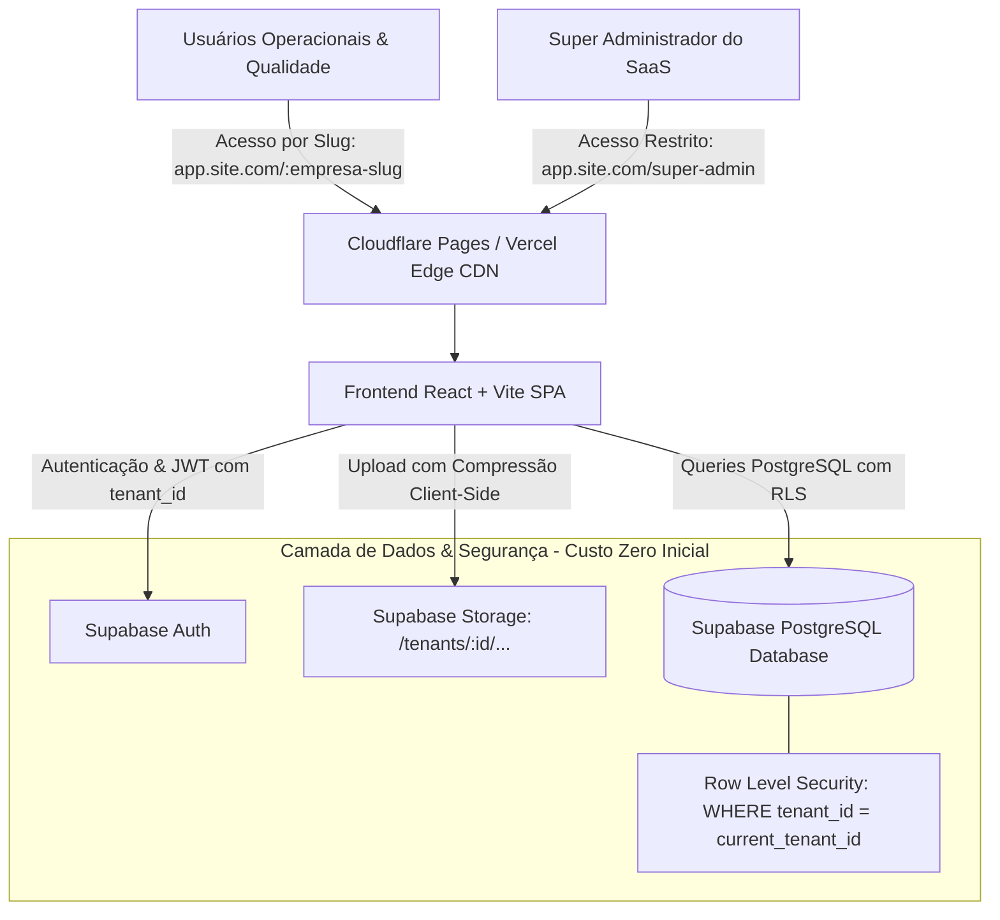
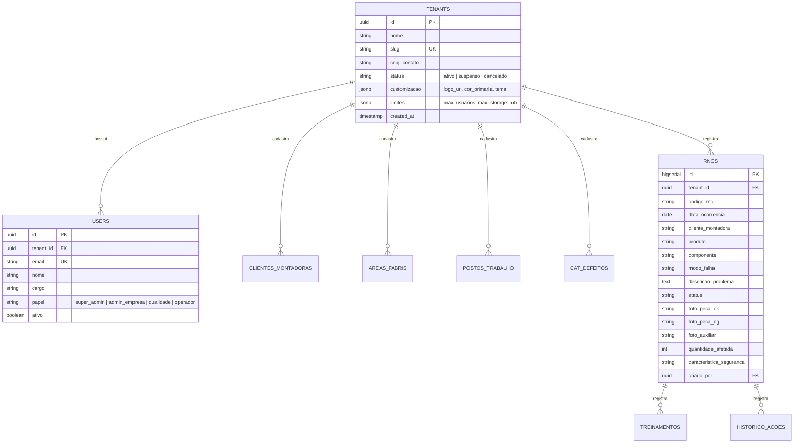
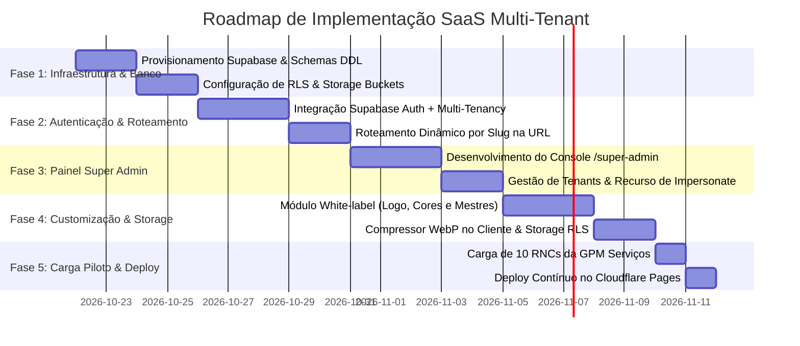

# Plano Estratégico de Implementação: Arquitetura SaaS Multi-Tenant (SOR Web)

> **Documento de Especificação e Roadmap de Execução**  
> **Status:** Planejamento Aprovado via `/grill-me`  
> **Meta:** Transformar o sistema SOR (Gestão de RNCs e Alerta de Qualidade) em uma plataforma **SaaS Multi-Tenant escalável**, segura, com controle central de Super Admin, isolamento estrito de dados, customização por empresa e custo inicial zero (R$ 0,00/mês).

---

## 1. Visão Geral da Arquitetura & Stack Tecnológica



### 1.1 Stack de Infraestrutura Selecionada (Melhor Custo-Benefício)

| Camada | Tecnologia / Provedor | Plano & Custo | Benefícios para o SaaS |
| :--- | :--- | :--- | :--- |
| **Frontend & CDN** | **Cloudflare Pages** (ou Vercel) | **Grátis ($0/mês)** | Tráfego e requisições ilimitadas, SSL automático, deploy contínuo direto do GitHub, baixa latência no Brasil. |
| **Banco de Dados** | **Supabase (PostgreSQL 15+)** | **Grátis ($0/mês)** | 500 MB de banco relacional estruturado (milhares de RNCs), Row Level Security nativo, backups e APIs instantâneas. |
| **Autenticação** | **Supabase Auth (GoTrue)** | **Grátis ($0/mês)** | Até 50.000 usuários ativos mensais (MAU), controle de sessões JWT seguras, metadados de tenant e papel de acesso. |
| **Storage de Fotos** | **Supabase Storage + WebP Client** | **Grátis ($0/mês)** | 1 GB de fotos (~3.500 a 4.000 fotos comprimidas em WebP), pastas particionadas por empresa e proteção por RLS. |
| **Domínio Inicial** | `*.pages.dev` / `*.vercel.app` | **Grátis ($0/mês)** | Permite testar e validar comercialmente a custo zero; preparado para plugar domínio próprio (ex: `app.meusaas.com.br`) em 5 minutos. |

---

## 2. Modelo de Dados Relacional Multi-Tenant (Schema PostgreSQL)

O modelo adota a abordagem **Shared Database, Shared Schema com Row Level Security (RLS)**, garantindo que mesmo se um desenvolvedor esquecer de filtrar por empresa no frontend, **o próprio banco de dados bloqueia qualquer vazamento de dados** entre empresas.



### 2.1 Políticas de Segurança Estrita (Row Level Security - RLS)

Cada tabela contém a coluna `tenant_id`. No banco de dados Supabase, ativamos a política:

```sql
-- Exemplo de política de isolamento total de RNCs
ALTER TABLE rncs ENABLE ROW LEVEL SECURITY;

CREATE POLICY "Isolamento Estrito por Tenant" ON rncs
FOR ALL
USING (
  tenant_id = (auth.jwt() -> 'app_metadata' ->> 'tenant_id')::uuid
  OR (auth.jwt() -> 'app_metadata' ->> 'is_super_admin')::boolean = true
);
```

---

## 3. Roteamento e Experiência do Usuário (Multi-Tenant por Slug)

### 3.1 Estrutura de URLs
1. **Acesso da Empresa:** `https://app.meusaas.com/:empresa-slug/login`
   * Ao carregar a URL, o app consulta os dados públicos do tenant (`nome`, `logo_url`, `cor_primaria`).
   * A tela de login é renderizada com a identidade visual da empresa cliente.
2. **Dashboard da Empresa:** `https://app.meusaas.com/:empresa-slug/dashboard`
   * Menus, cabeçalhos e cores adaptados dinamicamente com variáveis CSS (`--brand-primary: cor_da_empresa`).
   * Acesso aos 3 blocos de RNC, Alerta da Qualidade, Matriz de Treinamentos e Indicadores.
3. **Painel Central do Super Administrador:** `https://app.meusaas.com/super-admin`
   * Rota oculta e estritamente restrita ao usuário master do sistema (`is_super_admin = true`).

---

## 4. Funcionalidades do Painel de Super Administrador (`/super-admin`)

Como dono da plataforma SaaS, você terá um painel gerencial dedicado com as seguintes ferramentas:

1. **Gestão de Empresas (Tenants):**
   * **Listagem Geral:** Ver todas as empresas clientes, data de criação, quantidade de usuários, RNCs abertas e uso de armazenamento de fotos.
   * **Adicionar Nova Empresa:**
     * Nome da Empresa (ex: *GPM Serviços Industriais*).
     * Slug único para acesso (ex: `gpm-servicos`).
     * Dados de contato / CNPJ.
     * Definição de limites (máximo de usuários cadastrados, cota de fotos).
     * Criação imediata do primeiro Administrador da Empresa (Nome, E-mail e envio de link de ativação).
   * **Editar / Configurar Empresa:** Redefinir limites, atualizar dados cadastrais ou redefinir senha do administrador da empresa.
   * **Suspender / Ativar / Remover:** Bloqueio instantâneo do acesso da empresa em caso de inadimplência ou cancelamento.
2. **Recurso de "Acessar como a Empresa" (Impersonation):**
   * Permite que o Super Admin selecione qualquer empresa cadastrada e visualize exatamente o que ela vê, facilitando suporte técnico, treinamento e auditorias sem necessidade de saber a senha do cliente.
3. **Monitoramento Global de Consumo:**
   * Gráfico de RNCs geradas na plataforma, espaço total em disco utilizado pelas fotos e empresas mais ativas.

---

## 5. Personalização por Empresa (White-Label & Cadastros Mestres)

Cada empresa cliente acessa a tela de configurações (`/:empresa-slug/configuracoes`) para gerenciar:

1. **Identidade Visual da Empresa:**
   * Upload do Logo da Empresa (substitui o logo padrão no cabeçalho e nos alertas de impressão).
   * Seleção da Cor Primária da Marca (aplica tonalidades nos botões, badges e destaques do sistema).
   * Nome de exibição nos relatórios e fichas 8D impressas.
2. **Cadastros Mestres Isolados:**
   * **Montadoras / Clientes da Empresa:** Adicionar, editar ou desativar montadoras (ex: GM, Stellantis, VW, etc.).
   * **Linhas Fabris / FMDS:** Linhas de montagem próprias da fábrica.
   * **Postos de Trabalho:** Lista de postos e máquinas locais.
   * **Catálogo de Defeitos (Modos de Falha):** Defeitos específicos do processo da empresa.
   * **Gestão de Usuários Internos:** O Admin da empresa cria operadores, inspetores e analistas da sua própria equipe.

---

## 6. Otimização de Fotos e Armazenamento (Garantindo Custo Zero)

No chão de fábrica, operadores tiram fotos de câmeras de alta resolução (8 MB a 15 MB por foto). Para viabilizar a operação em planos gratuitos e conexões móveis lentas:

1. **Compressão Automática no Navegador (Client-Side Canvas/WebP):**
   * Antes do envio, a imagem é redimensionada para resolução máxima Full HD (1920x1080) e convertida para WebP com qualidade 80%.
   * **Resultado:** Redução de **~95%** no tamanho do arquivo (de 8 MB para ~250 KB a 300 KB), mantendo nitidez fotográfica perfeita para visualização do defeito técnico.
   * **Impacto no Custo:** O plano gratuito de 1 GB do Supabase passa a comportar até **~3.500 a 4.000 fotos** sem cobrar nada.
2. **Estrutura de Pastas no Supabase Storage:**
   * Caminho: `tenants/{tenant_id}/rncs/{rnc_id}/{tipo_foto}_{timestamp}.webp`
   * Acesso protegido por políticas de RLS no Storage: uma empresa nunca tem acesso ao bucket/pasta de outra.

---

## 7. Tenant Piloto e Carga de Dados Inicial (`GPM Serviços`)

Conforme sua definição, o sistema será inicializado com um Tenant Piloto oficial de demonstração:
* **Empresa:** `GPM Serviços`
* **Slug de Acesso:** `gpm-servicos` (URL: `app.site.com/gpm-servicos/login`)
* **Base de Dados Inicial:** **10 Ocorrências Formais Realistas** migradas e refinadas a partir da base atual:
  1. *Trinca no ponto de solda robotizada* (Item de Segurança - FMEA Crítico)
  2. *Rebarba excessiva em flange estampada* (Linha de Montagem)
  3. *Empolamento e contaminação em pintura superficial* (Acabamento)
  4. *Desvio dimensional em furação de fixação* (Usinagem/Conformação)
  5. *Falta de torque em parafuso estrutural M10* (Segurança do Produto)
  6. *Arranhão severo em superfície classe A visível* (Inspeção Final)
  7. *Inversão de chicote elétrico de comando* (Montagem Elétrica)
  8. *Porosidade interna detectada em teste de estanqueidade* (Fundição)
  9. *Deformação por impacto em transporte interno* (Logística/Kitting)
  10. *Etiqueta de rastreabilidade com código ilegível* (Expedição/Rastreabilidade)

---

## 8. Cronograma de Fases de Implementação (Roadmap)



### Detalhamento das 5 Fases:

#### **Fase 1: Infraestrutura e Modelagem do Banco (Supabase)**
- Criar projeto no Supabase (Região: São Paulo / sa-east-1 para menor latência).
- Executar scripts SQL de criação de tabelas (`tenants`, `users`, `rncs`, `treinamentos`, `clientes_montadoras`, `configuracoes`).
- Configurar Row Level Security (RLS) e regras de isolamento em todas as tabelas.
- Criar Bucket `evidencias-qualidade` com políticas de leitura/gravação isoladas por `tenant_id`.

#### **Fase 2: Camada de Autenticação e Roteamento no Frontend**
- Instalar cliente `@supabase/supabase-js`.
- Atualizar roteador React (`App.tsx`) para suportar captura dinâmica de slug (`/:tenantSlug/*`).
- Criar Contexto Global de Tenant (`TenantProvider` e `useTenant`), injetando a identidade da empresa no estado da aplicação.
- Tela de login contextualizada carregando logo e cores específicas da empresa.

#### **Fase 3: Módulo do Super Administrador (`/super-admin`)**
- Rota protegida exclusiva para o usuário master.
- Tabela de gestão de empresas com status, métricas de uso e ações (adicionar, suspender, editar).
- Formulário de onboarding de nova empresa com disparo de convite para o primeiro gestor da empresa.
- Função "Acessar como a Empresa" para suporte técnico direto.

#### **Fase 4: Módulo de Customização da Empresa & Otimização de Fotos**
- Tela de Configurações da Empresa para upload de logotipo e seletor de paleta de cores.
- Telas de manutenção dos Cadastros Mestres da empresa (Montadoras, Linhas, Postos e Defeitos).
- Implementação da biblioteca utilitária `imageCompressor.ts` no frontend para redução automática para WebP antes do envio.

#### **Fase 5: Carga Piloto (GPM Serviços) e Publicação na Web**
- Executar script de seed criando o tenant piloto `GPM Serviços` com logotipo e 10 RNCs formais completas.
- Configurar deploy automatizado no Cloudflare Pages a partir do repositório GitHub.
- Homologação completa de ponta a ponta: isolamento de dados, criação de nova empresa teste, geração de RNC com fotos e impressão.

---

## 9. Estimativa Orçamentária & Evolução de Escala

| Etapa do Negócio | Volume Estimado | Custos Mensais de Infraestrutura |
| :--- | :--- | :--- |
| **MVP / Validação Inicial** | 1 a 5 empresas cadastradas, até 50 usuários, ~2.000 fotos | **R$ 0,00 / mês** (100% coberto pelo Free Tier) |
| **Fase de Crescimento** | 6 a 25 empresas, até 500 usuários, ~25.000 fotos | **R$ 130,00 / mês** (Supabase Pro Plan $25/mês com 8 GB DB e 100 GB Storage) |
| **Escala Comercial** | Mais de 50 empresas industriais | **R$ 200 a R$ 350 / mês** (Supabase Pro + Cloudflare R2 para terabytes de fotos) |

---

## 10. Conclusão & Próximo Passo

Este plano transforma o SOR em um **produto SaaS profissional, seguro e de classe empresarial**, sem exigir investimentos iniciais em servidores caros e mantendo o código modular e fácil de manter.

> 💡 **Para prosseguir:** Quando você aprovar este plano, iniciaremos a execução passo a passo, começando pela criação dos scripts SQL do Supabase e a configuração da camada de serviços multi-tenant no frontend.
